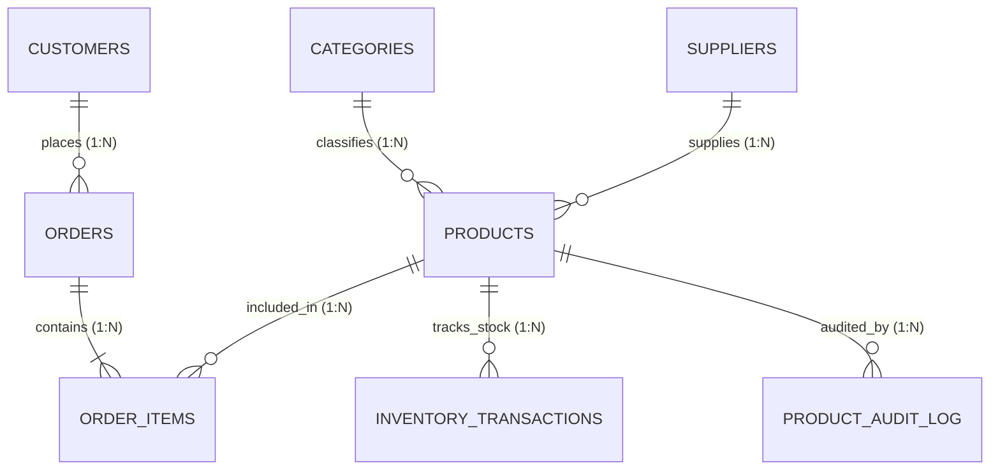

# Product Management System (DBMS Project)

An end-to-end, academic and industry-grade **Database Management System (DBMS)** project built for managing products, categories, suppliers, inventory stock movements, customer sales orders, and audit provenance.

Designed to demonstrate core relational database concepts: **Relational Schema Design**, **Normalization (3NF / BCNF)**, **Declarative Constraints**, **Database Triggers**, **Analytical Views**, **B-Tree Indexes**, **ACID Transactions**, and **Complex Analytical Queries**.

---

## 🌟 Key Features

### 1. Core DBMS Capabilities
- **Relational Schema (3NF / BCNF):** 8 relations modeling categories, suppliers, products, customers, orders, order items, inventory transactions, and audit logs.
- **Referential Integrity:** Foreign keys configured with `ON DELETE RESTRICT` and `ON DELETE CASCADE`.
- **Database Triggers:**
  - `trg_prevent_negative_stock`: Prevents any operation resulting in negative stock.
  - `trg_order_item_deduct_stock`: Automatically decreases product stock upon sale and logs into the inventory ledger.
  - `trg_order_cancelled_restore_stock`: Automatically restores stock and records `RETURN_IN` when an order is cancelled.
  - `trg_product_audit_update` & `trg_product_audit_insert`: Automatically records old and new field deltas as JSON in `product_audit_log`.
- **Analytical Views:**
  - `v_product_catalog`: Denormalized product overview with margin and stock health.
  - `v_low_stock_alerts`: Products needing immediate reordering with cost calculations.
  - `v_category_analytics`: Category-wise product counts and inventory values.
  - `v_supplier_performance`: Sourced capital and stock metrics per supplier.
  - `v_top_selling_products`: Revenue, volume, and profit ranking.
  - `v_sales_orders_summary`: Joined order ledger with customer metadata.
- **ACID Transaction Demonstration:** Atomic order processing with multi-product insertion and rollback on stock insufficiency.

### 2. Modern Interactive Web Application
- **Executive Dashboard:** Live KPI cards, Chart.js category distribution bar chart, stock health doughnut chart, top-selling products table, and recent movements ledger.
- **Product Management:** Full CRUD operations with search, category/supplier filters, stock status filter, sorting, and CSV export.
- **Inventory Ledger & Replenishment:** Real-time stock movement ledger (Purchases, Deductions, Returns) with a Low Stock Reorder Assistant.
- **Categories & Suppliers Management:** Normalized entities management with foreign key deletion guards.
- **Sales & Point of Sale (POS):** Multi-item order creation with real-time tax calculation and printable Tax Invoices.
- **Interactive SQL Console:** Run custom SQL queries directly against the live database with latency benchmarking and a library of 20 pre-built educational queries.
- **Visual ER Schema Visualizer:** Interactive data dictionary displaying columns, types, primary/foreign keys, and full trigger/view definitions.
- **Trigger Audit Trail:** Dedicated inspector displaying changes tracked by DBMS triggers.
- **1-Click Database Reset:** Re-seed the database anytime with clean demonstration data.

---

## 🚀 Quick Start Guide

### Prerequisites
- **Python 3.8+** installed on your system.

### Option 1: 1-Click Launch (Windows)
Double-click the provided batch file:
```cmd
run.bat
```
This automatically verifies Python, installs dependencies from `requirements.txt`, launches the database, and opens `http://127.0.0.1:5000` in your default browser.

### Option 2: Manual Terminal Execution
1. Install Flask:
   ```cmd
   pip install -r requirements.txt
   ```
2. Start the application:
   ```cmd
   python app.py
   ```
3. Open your browser and navigate to:
   ```
   http://127.0.0.1:5000
   ```

---

## 📁 Project Structure

```
roshan/
│
├── app.py                      # Flask Application entry point (Routes & Controllers)
├── database.py                 # Database connection manager, DDL runner, & ACID transactions
├── requirements.txt            # Python dependencies (Flask)
├── run.bat                     # 1-Click Windows execution script
├── product_management.db       # Active SQLite database file (Auto-generated)
│
├── sql/
│   ├── schema.sql              # DDL schema (Tables, Constraints, Indexes)
│   ├── triggers.sql            # Database Triggers (Stock sync, Audit, Validation)
│   ├── views.sql               # Analytical & Operational Views
│   ├── seed_data.sql           # Realistic sample dataset
│   ├── complex_queries.sql     # 20 Documented DBMS queries for lab/viva
│   └── mysql_compatible.sql    # MySQL / phpMyAdmin / XAMPP compatible DDL & Triggers
│
├── docs/
│   ├── DBMS_PROJECT_REPORT.md  # Comprehensive project synopsis & report
│   ├── ER_DIAGRAM.md           # ER Diagram & Schema architecture documentation
│   └── VIVA_QUESTIONS_ANSWERS.md # Top 30 DBMS Viva questions with answers
│
├── static/
│   ├── css/
│   │   └── style.css           # Custom styling & modern dashboard theme
│   └── js/
│       └── app.js              # Client-side UI utilities & notifications
│
└── templates/
    ├── base.html               # Master layout with responsive sidebar
    ├── index.html              # Executive dashboard with charts & KPIs
    ├── sql_playground.html     # Live SQL console & query library
    ├── er_diagram.html         # ER Schema visualizer & data dictionary
    ├── audit_logs.html         # Trigger audit log inspector
    │
    ├── products/
    │   ├── list.html           # Product catalog with search, filter, & CSV export
    │   ├── form.html           # Product creation & editing form
    │   └── detail.html         # Product specifications, stock logs, & audit trail
    │
    ├── inventory/
    │   ├── transactions.html   # Stock movement ledger & manual adjustment modal
    │   └── reorder.html        # Low-stock alert center & replenishment calculator
    │
    ├── categories/
    │   └── list.html           # Category management & analytics
    │
    ├── suppliers/
    │   └── list.html           # Supplier directory & vendor capital stats
    │
    └── orders/
        ├── list.html           # Customer orders ledger
        ├── create.html         # Point of sale / order creator with ACID transaction
        └── detail.html         # Tax invoice & order cancellation trigger demo
```

---

## 🗄️ Relational Database Schema



### Table Definitions
1. **`categories`**: Product classifications (`category_id` [PK], `category_code` [UK], `name` [UK], `description`).
2. **`suppliers`**: Vendor registry (`supplier_id` [PK], `name` [UK], `contact_name`, `email` [UK], `phone`, `city`).
3. **`products`**: Central product records (`product_id` [PK], `sku` [UK], `name`, `category_id` [FK], `supplier_id` [FK], `unit_price`, `cost_price`, `stock_quantity`, `reorder_level`).
4. **`customers`**: Customer accounts (`customer_id` [PK], `name`, `email` [UK], `phone`, `city`).
5. **`orders`**: Sales order headers (`order_id` [PK], `order_number` [UK], `customer_id` [FK], `order_date`, `status`, `total_amount`).
6. **`order_items`**: Associative bridge entity for M:N orders & products (`order_item_id` [PK], `order_id` [FK], `product_id` [FK], `quantity`, `unit_price`, `subtotal`).
7. **`inventory_transactions`**: Immutable ledger of stock movements (`transaction_id` [PK], `product_id` [FK], `transaction_type`, `quantity`, `reference_note`).
8. **`product_audit_log`**: Automated provenance logging (`audit_id` [PK], `product_id`, `action_type`, `old_values`, `new_values`, `timestamp`).

---

## 🎓 Academic Documents Included

- **Project Report (`docs/DBMS_PROJECT_REPORT.md`):** Complete formal documentation covering Abstract, Objectives, 1NF to BCNF Normalization proofs, DDL/DML, and Views.
- **ER Diagram Documentation (`docs/ER_DIAGRAM.md`):** Full ER diagram notations, cardinality mappings, and relational integrity constraints.
- **Viva Questions & Answers (`docs/VIVA_QUESTIONS_ANSWERS.md`):** Top 30 questions on ACID, Normalization, Triggers, Views, Indexes, and Joins.
- **Lab SQL Queries (`sql/complex_queries.sql`):** 20 production SQL queries demonstrating Multi-table joins, Correlated subqueries, Window functions (`DENSE_RANK()`, `SUM() OVER()`), and Set operations.
- **MySQL / phpMyAdmin Script (`sql/mysql_compatible.sql`):** Ready-to-import MySQL script if required for MySQL lab submission.

---

## 💻 Tech Stack
- **Database Engine:** SQLite 3 (Built-in, zero-configuration) + MySQL script included
- **Backend:** Python 3.13, Flask 3.x
- **Frontend:** HTML5, CSS3, Bootstrap 5.3, FontAwesome 6, Chart.js
- **Architecture:** Model-View-Controller (MVC) pattern with pure SQL DDL/DML execution
