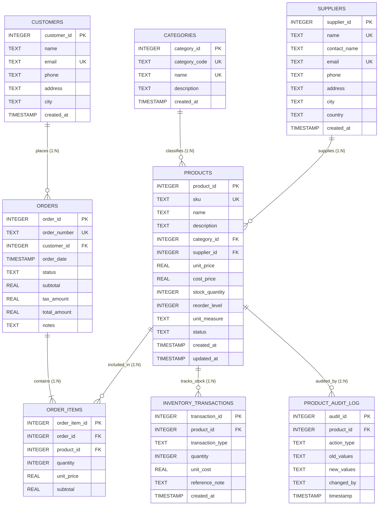

# Entity-Relationship (ER) Diagram & Schema Architecture
## Product Management System (DBMS)

### 1. Conceptual ER Diagram (Mermaid)

---

### 2. Entities & Relational Schema Notation

In formal relational algebra schema notation:

1. **`CATEGORIES`** (<u>`category_id`</u>, `category_code`*, `name`*, `description`, `created_at`)
2. **`SUPPLIERS`** (<u>`supplier_id`</u>, `name`*, `contact_name`, `email`*, `phone`, `address`, `city`, `country`, `created_at`)
3. **`PRODUCTS`** (<u>`product_id`</u>, `sku`*, `name`, `description`, `category_id`**, `supplier_id`**, `unit_price`, `cost_price`, `stock_quantity`, `reorder_level`, `unit_measure`, `status`, `created_at`, `updated_at`)
4. **`CUSTOMERS`** (<u>`customer_id`</u>, `name`, `email`*, `phone`, `address`, `city`, `created_at`)
5. **`ORDERS`** (<u>`order_id`</u>, `order_number`*, `customer_id`**, `order_date`, `status`, `subtotal`, `tax_amount`, `total_amount`, `notes`)
6. **`ORDER_ITEMS`** (<u>`order_item_id`</u>, `order_id`**, `product_id`**, `quantity`, `unit_price`, `subtotal`)
7. **`INVENTORY_TRANSACTIONS`** (<u>`transaction_id`</u>, `product_id`**, `transaction_type`, `quantity`, `unit_cost`, `reference_note`, `created_at`)
8. **`PRODUCT_AUDIT_LOG`** (<u>`audit_id`</u>, `product_id`, `action_type`, `old_values`, `new_values`, `changed_by`, `timestamp`)

*Legend:*
- <u>Underlined</u>: Primary Key (PK)
- Asterisk `*`: Candidate Key / Unique Constraint (UK)
- Double Asterisk `**`: Foreign Key (FK)

---

### 3. Cardinality & Relational Constraints

| Relationship | Entities Involved | Cardinality | Referential Integrity Rule |
| :--- | :--- | :--- | :--- |
| **Category - Product** | `categories` &rarr; `products` | 1 to Many (1:N) | `ON DELETE RESTRICT`, `ON UPDATE CASCADE` |
| **Supplier - Product** | `suppliers` &rarr; `products` | 1 to Many (1:N) | `ON DELETE RESTRICT`, `ON UPDATE CASCADE` |
| **Customer - Order** | `customers` &rarr; `orders` | 1 to Many (1:N) | `ON DELETE RESTRICT`, `ON UPDATE CASCADE` |
| **Order - Order Item** | `orders` &rarr; `order_items` | 1 to Many (1:N) | `ON DELETE CASCADE`, `ON UPDATE CASCADE` |
| **Product - Order Item** | `products` &rarr; `order_items` | 1 to Many (1:N) | `ON DELETE RESTRICT`, `ON UPDATE CASCADE` |
| **Product - Inventory Tx** | `products` &rarr; `inventory_transactions` | 1 to Many (1:N) | `ON DELETE CASCADE`, `ON UPDATE CASCADE` |
| **Orders - Products** | `orders` &harr; `products` | Many to Many (M:N) | Resolved via Associative Table `order_items` |

---

### 4. Integrity Constraints Summary
1. **Domain Constraints**: Data types (`INTEGER`, `REAL`, `TEXT`, `TIMESTAMP`).
2. **Entity Integrity**: Primary keys are never null and guarantee row uniqueness.
3. **Referential Integrity**: Foreign keys enforce references to valid parents.
4. **Check Constraints**:
   - `products.unit_price >= 0`
   - `products.cost_price >= 0`
   - `products.stock_quantity >= 0`
   - `products.reorder_level >= 0`
   - `order_items.quantity > 0`
   - `products.status IN ('Active', 'Discontinued', 'Draft')`
   - `orders.status IN ('Pending', 'Completed', 'Cancelled')`
